<!-- Original, self-hosted profile artwork. No remote stats widgets or copied animations. -->

<a href="https://tonmoy-portfolio-website.web.app/">
  <picture>
    <source media="(max-width: 640px)" srcset="./assets/hero-mobile.svg" />
    
  </picture>
</a>

  <strong>Product-minded engineering. A designer's eye for the details.</strong> 
  Bangladesh · UTC+6 · Open to engineering opportunities and thoughtful collaborations

  <a href="https://tonmoy-portfolio-website.web.app/"><strong>Portfolio ↗</strong></a> &nbsp; / &nbsp;
  <a href="https://drive.google.com/file/d/12tcVPBcikN-s_HaD-GdjZrkbygLFv7td/view?usp=share_link"><strong>Resume ↗</strong></a> &nbsp; / &nbsp;
  <a href="mailto:tonmoyofficial29@gmail.com"><strong>Let's talk ↗</strong></a>

  <a href="#about">About</a> &nbsp; · &nbsp;
  <a href="#flagship-build">Flagship</a> &nbsp; · &nbsp;
  <a href="#selected-work">Projects</a> &nbsp; · &nbsp;
  <a href="#capabilities">Capabilities</a> &nbsp; · &nbsp;
  <a href="#github-in-3d">3D activity</a> &nbsp; · &nbsp;
  <a href="#lets-build">Contact</a>

---

## About

I'm **Tanver Islam Tonmoy**, a full-stack developer and UI/UX designer from Bangladesh. I work where **engineering, visual design and usability** meet—building web applications and exploring local-first native software.

I care about what happens after the first impression: understandable interfaces, useful loading and error states, maintainable components, and clear boundaries between what a product promises and what it actually does.

> Useful first. Considered in the details. Built to keep improving.

- **Design with intent.** Visual hierarchy, responsive layouts and motion that supports the task.
- **Connect the pieces.** Frontend, APIs, data models and content workflows—not just isolated screens.
- **Refine the experience.** Keyboard flows, recovery paths, edge cases and the details that make software feel considered.

## Flagship build

### VaultZero

**Exploring privacy-focused software as a product experience.**

A password-manager project combining a Rust core, Tauri desktop integration and a React/TypeScript interface. The work brings together encrypted local storage, recovery flows and a calm, bilingual credential workspace.

- Local vault, search and credential management
- TOTP, CSV import and recovery-key flows
- OCR and QR-transfer experiments
- English and বাংলা interface support

**Built with:** `Rust` · `Tauri 2` · `React` · `TypeScript`

The repository includes separate core modules, native IPC, browser and native storage paths, Rust tests, browser tests and build/release workflows.

**[Explore the source ↗](https://github.com/tonmoycoder/VaultZero)** &nbsp; · &nbsp; **[Releases ↗](https://github.com/tonmoycoder/VaultZero/releases)** &nbsp; · &nbsp; **[Security notes ↗](https://github.com/tonmoycoder/VaultZero/blob/main/SECURITY.md)**

Active development. Security-sensitive features are experimental; this profile does not claim an independent security audit. Review the implementation and its limitations before relying on it.

## Selected work

### Math Academy · Darshana

**A Bengali-first learning experience, built around a local academy's needs.**

A mobile-first website for a mathematics academy in Darshana, Chuadanga: interactive learning sections, managed batch information and a Markdown-backed educational blog. A Python publishing pipeline works alongside a Node.js API and Neon Postgres content layer.

- Bengali content, responsive layouts and visual learning interactions
- Editable batch, fee and seat information, with API validation
- Generated blog routes, metadata and a downloadable resource section
- Local API contract tests and documented deployment checks

`JavaScript` · `CSS` · `Python` · `Node.js` · `Neon Postgres` · `Vercel`

**[Source & setup ↗](https://github.com/tonmoycoder/Math-Academy-Darsana)** &nbsp; · &nbsp; **[Deployment notes ↗](https://github.com/tonmoycoder/Math-Academy-Darsana/blob/main/docs/DEPLOY-VERCEL.md)**

### Bismillah Pakhi & Aquarium

**A storefront that connects product presentation with content management.**

A CMS-powered pet catalogue and enquiry platform. Next.js and Payload connect the public-facing experience to structured product, animal, media and blog content—with Bengali/English fields and an administrative editing workflow.

- Product and animal discovery, detail pages and shortlist interactions
- Payload collections, PostgreSQL data and media management
- Search, contact workflows and bilingual content
- Playwright coverage for selected interface flows

`Next.js` · `TypeScript` · `Payload CMS` · `PostgreSQL` · `Tailwind CSS`

**[Explore the source ↗](https://github.com/tonmoycoder/Pet-Shot-Full-Stack)**

  
<strong>Earlier work & interface experiments</strong>

These are learning projects, not substitutes for the current work above.

- **[Doctors Portal](https://github.com/tonmoycoder/doctors-portal-client-side-practice)** — appointment, dashboard and payment-interface studies. [Server source](https://github.com/tonmoycoder/doctors-portal-server).
- **[Learning Platform](https://github.com/tonmoycoder/Learning-Platform)** — course browsing, Firebase authentication and protected-route practice.
- **[Harper Courier](https://github.com/tonmoycoder/Harper-Client-Side)** — service reviews and CRUD workflows.
- **[Number-to-word converter](https://github.com/tonmoycoder/Number-To-Word-Converter)** — a small JavaScript utility experiment.
- **[More repositories](https://github.com/tonmoycoder?tab=repositories)** — the rest of the learning trail.

## Capabilities

<table>
  <tr>
    <td width="50%" valign="top">
      <h3>Frontend & product UI</h3>
      
<strong>React · Next.js · TypeScript · JavaScript</strong>

      
Responsive component architecture, CSS/Tailwind, visual hierarchy, motion and accessibility-conscious interaction design.

    </td>
    <td width="50%" valign="top">
      <h3>Backend & content</h3>
      
<strong>Node.js · Express · PostgreSQL · MongoDB</strong>

      
API integration, data modelling, Payload CMS, Firebase authentication and managed content workflows.

    </td>
  </tr>
  <tr>
    <td width="50%" valign="top">
      <h3>Native & local-first</h3>
      
<strong>Rust · Tauri · Encrypted storage</strong>

      
Exploring native application boundaries, offline-first workflows and understandable recovery experiences.

    </td>
    <td width="50%" valign="top">
      <h3>Design & delivery</h3>
      
<strong>Figma · Git · Playwright · GitHub Actions</strong>

      
Interface studies, design-to-code iteration, automated checks and documented deployment workflows.

    </td>
  </tr>
</table>

## How I build

  <kbd>UNDERSTAND</kbd> → <kbd>STRUCTURE</kbd> → <kbd>DESIGN</kbd> → <kbd>BUILD</kbd> → <kbd>VERIFY</kbd>

1. **Start with the problem.** Understand the user, the friction and the constraints before choosing a framework.
2. **Connect design and architecture.** Make visual decisions work with the data model, component boundaries and performance budget.
3. **Test the uncomfortable paths.** Loading, failure, recovery, keyboard use and small screens belong in the product—not in an afterthought.

## Proof of work

| What to inspect | A place to start |
| :--- | :--- |
| Local-first application architecture | [VaultZero's Rust core](https://github.com/tonmoycoder/VaultZero/tree/main/crates/vault-core) and [frontend storage paths](https://github.com/tonmoycoder/VaultZero/blob/main/src/lib/storage.ts) |
| Content modelling and full-stack integration | [Pet platform collections](https://github.com/tonmoycoder/Pet-Shot-Full-Stack/tree/main/src/collections) and [application routes](https://github.com/tonmoycoder/Pet-Shot-Full-Stack/tree/main/src/app) |
| Publishing pipelines and API contracts | [Math Academy's build pipeline](https://github.com/tonmoycoder/Math-Academy-Darsana/blob/main/_src/build.py) and [API tests](https://github.com/tonmoycoder/Math-Academy-Darsana/blob/main/tests/api.test.mjs) |

## GitHub in 3D

  One year, one day at a time. Contribution height is activity—not a measure of code quality. 
  Self-hosted SVG · Public calendar data · Daily workflow · No personal access token 
  <a href="./docs/PROFILE.md">How this profile is built ↗</a>

## Let's build

**Have a useful product to build—and care how it feels to use?**

I'm interested in product-focused frontend/full-stack engineering, design systems, creative interfaces and local-first applications. I enjoy work where engineering quality and visual craft are treated as parts of the same product.

**[Email me ↗](mailto:tonmoyofficial29@gmail.com)** &nbsp; · &nbsp; **[Connect on LinkedIn ↗](https://www.linkedin.com/in/tanverislamtonmoyofficial/)** &nbsp; · &nbsp; **[Explore my portfolio ↗](https://tonmoy-portfolio-website.web.app/)**

---

  <a href="https://dev.to/tonmoy">Dev.to</a> &nbsp; / &nbsp;
  <a href="https://codepen.io/tonmoy98981085">CodePen</a> &nbsp; / &nbsp;
  <a href="https://stackoverflow.com/users/14840269/tonmoy">Stack Overflow</a> &nbsp; / &nbsp;
  <a href="https://dribbble.com/tonmoy_official">Dribbble</a>

  <strong>Designed & built by Tanver Islam Tonmoy.</strong> 
  Useful first. Better with every iteration.

